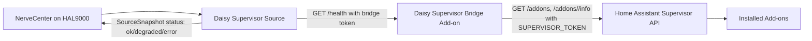

# Daisy Supervisor Add-on Health Monitoring Spec

Date: 2026-06-28

## Summary

NerveCenter currently reports the KITT-hosted UPS correctly, but it does not observe Daisy's Home Assistant Supervisor add-on state. Daisy's Home Assistant NUT add-on can therefore be in `error` while NerveCenter still reports Daisy as healthy, because NerveCenter only checks Home Assistant Core availability and curated HA entity state.

This spec adds read-only Supervisor add-on monitoring for Daisy. The fix has two parts:

1. A small Daisy-local Supervisor bridge that can read Supervisor add-on state using `SUPERVISOR_TOKEN` and expose sanitized health JSON to NerveCenter.
2. A new NerveCenter Daisy source that polls the bridge, marks Daisy degraded/error when monitored add-ons are unhealthy, and records enough detail to make the problem visible in the dashboard/source pages.

The first monitored add-on should be Daisy's Home Assistant NUT add-on, `a0d7b954_nut`, but the design should support additional Supervisor add-ons without another custom source.

## Current State

### What Is Working

- NerveCenter has a separate `UPS` device configured against KITT:
  - `nut_host: "100.97.130.40"`
  - `nut_port: 3493`
  - `nut_device: "cyberpower"`
  - source: `NerveCenter.Sources.Ups.NUTSource`
- KITT's NUT server is healthy and returns normal UPS readings.
- HAL9000 and Rosie can both query KITT's NUT server.
- NerveCenter exports fresh UPS metrics every 30 seconds for `device_id="ups", source="nut"`.

### What Is Broken

Daisy's Home Assistant Supervisor reports the installed NUT add-on as unhealthy:

- Add-on slug: `a0d7b954_nut`
- Add-on state: `error`
- Container status: `Exited (1) 9 days ago`
- Current add-on options include:
  - `mode: netserver`
  - `network: {"3493/tcp": null}`
  - `users[0].username: ""`
  - `users[0].password: ""`

The add-on log explains the immediate failure:

```text
Setting a username is required!
Please username in the 'users[0].username' option.
```

### Why NerveCenter Does Not Report It

Daisy is configured with only these NerveCenter sources:

- `:ha_web_socket` via `NerveCenter.Sources.Daisy.HAWebSocketSource`
- `:ha_rest_probe` via `NerveCenter.Sources.Daisy.HARestProbe`

The REST probe checks Home Assistant Core's `/api/config` endpoint. That proves Core is reachable and running, but it does not include Supervisor add-on health. The WebSocket source tracks curated entity IDs and does not subscribe to Supervisor add-on state.

As a result, Daisy can be healthy at the Home Assistant Core level while a Supervisor add-on is broken.

## Research Findings

### Supervisor API

Home Assistant's Supervisor API exposes the data NerveCenter needs:

- `GET /addons`: overview of installed add-ons/apps and their states.
- `GET /addons/<addon>/info`: detailed add-on/app info, including state, version, network config, and options.
- `GET /addons/<addon>/logs/latest`: latest startup logs, with a `lines` query parameter.
- `GET /supervisor/info`: Supervisor health/version/support status.

The Supervisor API documentation marks these endpoints as protected and says they require a Bearer token from the `SUPERVISOR_TOKEN` environment variable.

Source: <https://developers.home-assistant.io/docs/api/supervisor/endpoints/>

### Access Boundary

The existing NerveCenter `HA_TOKEN` can call Home Assistant Core endpoints such as `/api/config`, but Daisy returns `401` for external calls to `/api/hassio/addons` and `/api/hassio/addons/a0d7b954_nut/info`.

Inside the Home Assistant Core container, calls to `http://supervisor/addons` and `http://supervisor/addons/a0d7b954_nut/info` succeed with the container's `SUPERVISOR_TOKEN`.

Home Assistant's add-on communication docs describe this boundary: add-ons can call `http://supervisor/` using the `SUPERVISOR_TOKEN` when `hassio_api: true` is enabled.

Source: <https://developers.home-assistant.io/docs/add-ons/communication/>

### Add-on Configuration

The NUT add-on's own configuration schema includes required `users[].username` and `users[].password` fields, and its default config has empty values. The docs tell users to configure `users` and `devices` before starting the add-on. The current Daisy failure matches this exactly.

Sources:

- <https://github.com/hassio-addons/addon-nut/blob/main/nut/config.yaml>
- <https://github.com/hassio-addons/addon-nut/blob/main/nut/DOCS.md>

## Goals

1. Make Daisy's Supervisor add-on failures visible in NerveCenter.
2. Make the current `a0d7b954_nut` failure show Daisy as degraded/error without relying on manual SSH checks.
3. Avoid printing or storing Supervisor tokens, HA tokens, NUT passwords, or raw add-on option secrets.
4. Keep the existing KITT UPS/NUT monitoring intact.
5. Build a reusable path for monitoring additional Supervisor add-ons later.
6. Preserve NerveCenter's existing source model, snapshot store, metrics exporter, and source detail pages where possible.

## Non-Goals

- Do not auto-fix Daisy's NUT configuration.
- Do not restart, stop, update, install, uninstall, or mutate Home Assistant add-ons.
- Do not replace the KITT-hosted UPS source.
- Do not expose raw Supervisor API access to NerveCenter.
- Do not store add-on passwords or raw add-on config in NerveCenter.
- Do not build a full Home Assistant Supervisor management UI.

## Approaches Considered

### Option A: Directly Poll `/api/hassio/...` from NerveCenter

NerveCenter would reuse `HA_TOKEN` and call Daisy's Home Assistant frontend/Supervisor proxy routes directly.

Pros:

- Smallest NerveCenter-only code change if it worked.
- No new Daisy component.

Cons:

- It does not work today: Daisy returns `401` with the existing long-lived HA token.
- The supported Supervisor API auth model is `SUPERVISOR_TOKEN`, which is intentionally available inside HA/add-on contexts, not to outside clients.
- It risks coupling NerveCenter to frontend/internal proxy behavior.

Decision: reject.

### Option B: Poll Daisy over SSH and Run `ha addons`

NerveCenter would SSH into Daisy and run `sudo docker exec hassio_cli ha addons` or `ha addons info <slug>`.

Pros:

- Works with the current machine state.
- No Home Assistant add-on development required.
- Easy for a human to debug.

Cons:

- Couples production monitoring to SSH availability, shell behavior, CLI output, and Docker container names.
- Requires NerveCenter to hold/use SSH credentials or shell out with host-specific assumptions.
- Harder to test cleanly than an HTTP JSON source.
- Less appropriate as a recurring health source.

Decision: keep as a manual diagnostic fallback, not the production monitoring path.

### Option C: Expose Supervisor State Through Home Assistant Entities

Create Home Assistant sensors/helpers that expose add-on state, then let the existing HA WebSocket source observe those entities.

Pros:

- Reuses the existing HA WebSocket source.
- No new NerveCenter source type.

Cons:

- Requires Home Assistant configuration/automation work that may itself depend on Supervisor access.
- The curated-entity source is designed for user-facing entity snapshots, not infrastructure health.
- Entity names and state payloads would be indirect and less precise than Supervisor API data.
- Harder to include sanitized config warnings such as blank NUT username.

Decision: possible later if HA already exposes the right entities, but not recommended as the primary fix.

### Option D: Daisy-local Add-on Publishes One Sanitized HA/MQTT State

Install a Daisy-local add-on that reads Supervisor state internally, then publishes one sanitized Home Assistant entity or MQTT state. NerveCenter would observe that state through the existing HA WebSocket source or an existing MQTT path, avoiding a new HTTP port.

Pros:

- Keeps `SUPERVISOR_TOKEN` inside Daisy.
- Avoids exposing a new HTTP listener from Daisy.
- Can reuse the existing HA WebSocket source if the state appears as a normal Home Assistant entity.

Cons:

- Gives NerveCenter less structured source detail unless the entity payload is JSON and the existing source is expanded to parse it.
- Couples infrastructure health to Home Assistant entity/MQTT configuration.
- Makes source-level status less direct; NerveCenter would need to translate one entity state into Daisy device health.
- Still requires a Daisy-local add-on or automation to read Supervisor state.

Decision: keep as the fallback if the HTTP bridge port is considered too much exposure. The HTTP bridge remains recommended because it gives NerveCenter a narrow, testable, structured source with source-level status and no raw Supervisor access.

### Option E: Daisy-local Read-only Supervisor Bridge plus NerveCenter Source

Install a small Daisy-local bridge as a Home Assistant local add-on. The bridge gets `SUPERVISOR_TOKEN` from Home Assistant, calls read-only Supervisor endpoints, sanitizes the response, and exposes a narrow HTTP JSON endpoint protected by a separate bridge token. NerveCenter polls that endpoint with a new Daisy source.

Pros:

- Uses the supported Supervisor access model.
- Keeps the Supervisor token inside Daisy.
- Produces stable JSON for NerveCenter and tests.
- Can whitelist monitored add-ons and redact raw config.
- Works for NUT now and other add-ons later.
- Separates "Home Assistant Core is reachable" from "Supervisor add-ons are healthy."

Cons:

- Requires installing/maintaining a small local add-on on Daisy.
- Adds one NerveCenter environment variable for bridge auth.
- Needs a small amount of deployment documentation.

Decision: recommended.

## Recommended Architecture



### Component 1: Daisy Supervisor Bridge

Create a small Home Assistant local add-on, stored in this repo under something like:

```text
deploy/daisy-supervisor-bridge/
  config.yaml
  Dockerfile
  run.py
  README.md
```

The add-on should:

- Set `hassio_api: true`.
- Start with the least Supervisor role that can read `/addons`, `/addons/<slug>/info`, and `/supervisor/info`; verify this on Daisy during implementation before falling back to a broader role.
- Expose one HTTP endpoint to NerveCenter, for example `GET /health`.
- Require `Authorization: Bearer <bridge-token>` on every request.
- Read the bridge token from add-on options, not from source code.
- Call Supervisor internally at `http://supervisor/...` with `SUPERVISOR_TOKEN`.
- Use an explicit Home Assistant add-on `ports` mapping for host exposure, not `host_network`.
- Bind only the add-on HTTP server's configured container port; do not enable `host_network: true`.
- Return JSON only.
- Treat Supervisor add-on `options` as secret-bearing by default. Do not emit `config_summary` for an add-on unless there is an explicit allowlisted sanitizer for that add-on's `config_checks`.
- Never return:
  - `SUPERVISOR_TOKEN`
  - HA long-lived tokens
  - raw add-on passwords
  - NUT passwords
  - unfiltered add-on options

Recommended bridge endpoint:

```http
GET /health
Authorization: Bearer <bridge-token>
Accept: application/json
```

Recommended response:

```json
{
  "observed_at": "2026-06-28T13:03:42Z",
  "supervisor": {
    "version": "2026.06.2",
    "version_latest": "2026.06.2",
    "update_available": false,
    "healthy": true,
    "supported": true,
    "channel": "stable"
  },
  "addons": [
    {
      "slug": "a0d7b954_nut",
      "name": "Network UPS Tools",
      "state": "error",
      "version": "0.18.0",
      "version_latest": "0.18.0",
      "update_available": false,
      "available": true,
      "boot": "auto",
      "startup": "system",
      "protected": true,
      "network": {
        "3493/tcp": null
      },
      "config_summary": {
        "mode": "netserver",
        "shutdown_host": false,
        "device_count": 1,
        "users": [
          {
            "username_set": false,
            "password_set": false,
            "upsmon": null
          }
        ]
      },
      "config_warnings": [
        {
          "code": "nut_username_blank",
          "severity": "critical",
          "message": "NUT add-on user 1 has a blank username."
        },
        {
          "code": "nut_password_blank",
          "severity": "critical",
          "message": "NUT add-on user 1 has a blank password."
        },
        {
          "code": "nut_port_unmapped",
          "severity": "warning",
          "message": "NUT add-on port 3493/tcp is not mapped to a host port."
        }
      ]
    }
  ]
}
```

Bridge config should define which add-ons are returned and how the service is exposed. For the first version:

```yaml
name: Daisy Supervisor Bridge
slug: daisy_supervisor_bridge
version: "0.1.0"
description: Read-only sanitized Home Assistant Supervisor add-on health for NerveCenter
arch:
  - amd64
startup: system
hassio_api: true
hassio_role: default
host_network: false
ports:
  9567/tcp: 9567
ports_description:
  9567/tcp: Read-only sanitized Supervisor health API for NerveCenter
options:
  token: ""
  watched_addons:
    - a0d7b954_nut
schema:
  token: password
  watched_addons:
    - str
```

The manifest example above must be installable as a Home Assistant local add-on. If implementation targets additional Daisy architectures later, add them to `arch` only after testing the image build for those platforms.

The Dockerfile must follow current Home Assistant add-on expectations:

- Use a supported Home Assistant add-on base image through `ARG BUILD_FROM` / `FROM $BUILD_FROM`.
- Install only the small Python runtime/dependencies needed by the bridge.
- Copy `run.py` and any testable helper modules into the image.
- Start the bridge through the add-on's normal run command without requiring `host_network`.
- Do not bake the bridge token or any Home Assistant/Supervisor token into the image.

If `hassio_role: default` cannot read the required Supervisor endpoints during implementation, increase the role only as far as necessary and document the observed failure and required role in `deploy/daisy-supervisor-bridge/README.md`.

The bridge must fail fast at startup when:

- `token` is blank.
- `token` is shorter than 32 characters.
- `watched_addons` is empty.
- the configured HTTP port is unavailable.

The exposed port should be reachable only on Hal's trusted network/Tailnet path. The implementation documentation should include a Daisy/Home Assistant network check and, if HA OS exposes firewall controls for local add-ons in this environment, the bridge should be restricted to HAL9000/NerveCenter clients. If host-level firewalling is unavailable, the token requirement and lack of mutating endpoints are mandatory compensating controls.

The bridge should return:

- `200` with health JSON when Supervisor calls succeed.
- `401` when the bridge token is missing or invalid, with a generic sanitized body such as `{"error":"unauthorized"}`.
- `502` when the Supervisor API is unreachable or returns non-2xx, with a generic sanitized body such as `{"error":"supervisor_unavailable"}`.
- `500` only for bridge bugs, with a generic sanitized body such as `{"error":"bridge_error"}`.

It should include no mutating endpoints.

### Component 2: NerveCenter Supervisor Source

Add a polling source:

```text
lib/nerve_center/sources/daisy/ha_supervisor_source.ex
test/nerve_center/sources/daisy/ha_supervisor_source_test.exs
```

Suggested module name:

```elixir
NerveCenter.Sources.Daisy.HASupervisorSource
```

Required environment:

```elixir
def required_env, do: ["DAISY_SUPERVISOR_BRIDGE_TOKEN"]
```

Device config additions:

```elixir
supervisor_bridge_base_url: "http://100.103.249.3:9567",
supervisor_addons: [
  %{
    slug: "a0d7b954_nut",
    label: "Network UPS Tools",
    required: true,
    expected_states: ["started"],
    config_checks: [:nut_addon]
  }
]
```

`supervisor_addons` in NerveCenter and `watched_addons` in the bridge intentionally duplicate the watched slug list at two trust boundaries:

- The bridge list controls what Daisy is willing to expose.
- The NerveCenter list controls what NerveCenter expects and how required/optional health is interpreted.

If NerveCenter requires an add-on that the bridge omits, the source should treat that as semantic `:error` with a config-drift problem such as `bridge_missing_required_addon`. The deployment checklist must verify both lists contain `a0d7b954_nut`.

If NerveCenter configures an optional add-on that the bridge omits, the source should treat that as semantic `:degraded` with a config-drift warning such as `bridge_missing_optional_addon`. Optional drift should not be data-only because it means NerveCenter is not actually observing a configured dependency.

Source config:

```elixir
%{
  name: :ha_supervisor,
  module: NerveCenter.Sources.Daisy.HASupervisorSource,
  enabled: true,
  interval_ms: 60_000
}
```

Polling behavior:

1. `probe/1` should record the bridge base URL, watched add-ons, and protocol.
2. `poll/1` should call `GET #{base_url}/health` with the bridge token.
3. `normalize/2` should:
   - parse Supervisor health fields
   - filter/validate expected add-ons from config
   - compute problem list
   - compute source status
   - emit metrics
   - emit transition events
   - return sanitized data for source/detail pages

Recommended source status mapping:

| Condition | Source status |
| --- | --- |
| Bridge transport/auth failure | existing runner failure path |
| Supervisor `healthy == false` | `:error` |
| Supervisor `supported == false` | `:degraded` |
| Required add-on missing | `:error` |
| Required add-on state not in `expected_states` | `:error` |
| Required add-on has critical config warning | `:error` |
| Optional add-on omitted by bridge | `:degraded` |
| Optional add-on unhealthy | `:degraded` |
| Update available only | `:degraded` if configured as warning, otherwise data-only |
| No problems | `:ok` |

For current Daisy, the new source should compute `:error` because `a0d7b954_nut` is required, state is `error`, and config warnings include blank username/password.

### Component 3: Semantic Source Status Support

NerveCenter's generic polling runner currently sets every successful normalized payload to `SourceSnapshot.status = :ok`. That works for metric sources but not for health-check sources where the poll succeeds and reports an unhealthy subject.

Extend `NerveCenter.Runtime.PollingSourceRunner` so normalized payloads may optionally include:

```elixir
%{
  status: :ok | :degraded | :error | :offline | :stale | :unknown,
  observed_at: DateTime.t(),
  metrics: [...],
  data: %{...},
  events: [...],
  private: %{...}
}
```

Rules:

- If `payload.status` is absent, keep current behavior and use `:ok`.
- If `payload.status` is present, use it for `SourceSnapshot.status`.
- The runner should still call `AppHealth.record_source_success/3` because the source itself successfully polled.
- `AppHealth` failure counts should remain reserved for source transport/auth/callback failures.
- The source snapshot should include `last_error`/`last_error_at` only for actual source failures, not semantic add-on health. Put semantic details in `data.summary` and persisted `device_events`.
- Do not add a `health_message` field to `SourceSnapshot`; place human-readable semantic health text in `data.summary.message`.
- Update recovery logging so successful-but-semantic-`:error` or `:degraded` payloads do not log misleading "recovered" messages every poll. Recovery logs should mean recovery from source transport/auth/callback failure or transition back to semantic `:ok`.
- Track semantic status transitions separately from transport failures when deciding whether to log. A semantic `:error` that remains `:error` should not produce repeated recovery logs.

Make the same semantic status change in `NerveCenter.Runtime.ManualControl.refresh_source/2`. Manual refresh currently publishes successful normalized payloads as `:ok`; after this change it must use `payload.status || :ok` exactly like the polling runner. A manual refresh of `daisy/ha_supervisor` must not overwrite a semantic `:error` with `:ok`.

This preserves the distinction between:

- "NerveCenter cannot talk to the source."
- "NerveCenter can talk to the source, and the source reports the monitored service is unhealthy."

### Component 4: Events and Problem Fingerprints

The source should persist device events for add-on health transitions without spamming the event table every poll.

Use `context.private` in `normalize/2` to track the last set of problem fingerprints:

```elixir
fingerprint = "#{addon.slug}:#{problem.code}:#{problem.value}"
```

Emit events only when:

- a new problem fingerprint appears
- an existing problem fingerprint disappears
- a monitored add-on's state changes

Suggested event types:

- `ha_supervisor_addon_problem`
- `ha_supervisor_addon_recovered`
- `ha_supervisor_unhealthy`
- `ha_supervisor_recovered`

Example event message:

```text
Network UPS Tools add-on is error; critical config warnings: nut_username_blank, nut_password_blank.
```

### Component 5: Metrics

Add aggregate metrics to `NerveCenter.Metrics.Catalog`:

```elixir
ha_supervisor_healthy_flag
ha_supervisor_supported_flag
ha_supervisor_required_addons_unhealthy_count
ha_supervisor_optional_addons_unhealthy_count
ha_supervisor_addons_update_available_count
ha_supervisor_addons_config_warning_count
```

Use aggregate metrics because the current metrics exporter does not support per-metric dynamic labels such as `addon_slug`.

Detailed per-add-on state should live in source `data`, not in Prometheus-style metrics.

These metrics are context, not the primary alerting path. The primary health signal is `SourceSnapshot.status`, which will degrade the Daisy device in NerveCenter. The current metrics exporter only exports metrics for sources whose current snapshot status is `:ok`; this feature should not depend on changing that behavior.

### Component 6: UI Surface

Minimum UI changes:

1. Add `ha_supervisor: "HA Supervisor"` to `NerveCenterWeb.Display.source_name/1`.
2. Ensure Daisy's device status becomes `:degraded` when only the new source is `:error` and the HA REST/WebSocket sources are `:ok`.
3. Let `/sources/daisy/ha_supervisor` show the sanitized current data.

Recommended UI follow-up:

Add a tailored add-on table to `SourceLive` for `:ha_supervisor` with columns:

- Add-on
- State
- Version
- Update
- Required
- Config warnings

This is useful but not required for the first functional fix because the generic data view already exposes current data.

## Data Model

The source's `data` payload should be stable and sanitized:

```elixir
%{
  summary: %{
    status: :error,
    problem_count: 3,
    required_unhealthy_count: 1,
    optional_unhealthy_count: 0,
    update_available_count: 0,
    message: "Network UPS Tools add-on is error; critical config warnings: nut_username_blank, nut_password_blank."
  },
  supervisor: %{
    version: "2026.06.2",
    version_latest: "2026.06.2",
    update_available: false,
    healthy: true,
    supported: true,
    channel: "stable"
  },
  addons: [
    %{
      slug: "a0d7b954_nut",
      label: "Network UPS Tools",
      state: "error",
      expected_states: ["started"],
      required: true,
      version: "0.18.0",
      version_latest: "0.18.0",
      update_available: false,
      config_warnings: [
        %{code: "nut_username_blank", severity: "critical"},
        %{code: "nut_password_blank", severity: "critical"}
      ]
    }
  ]
}
```

No raw `options` map should be stored in snapshots, probes, events, logs, or metrics.

## Error Handling

### Bridge Errors

- Missing/invalid bridge token: return `401` with a generic error body.
- Supervisor API auth failure inside bridge: return `502` and log only a generic "Supervisor API authorization failed" message.
- Supervisor unreachable: return `502`.
- Individual add-on info failure:
  - If `/addons` succeeds but `/addons/<slug>/info` fails for one watched add-on, include that add-on with `state: "unknown"` and a bridge warning.
  - Return `200` if the bridge still produced a complete response shape.

### NerveCenter Source Errors

- Bridge `401`/`403`: classify as a sanitized auth error such as `{:auth, status, :supervisor_bridge_unauthorized}`, triggering auth backoff.
- Bridge `5xx`: classify as a sanitized bridge error such as `{:http, status, :supervisor_bridge_unavailable}` and let the polling runner handle backoff.
- Malformed response: return `{:error, {:invalid_supervisor_bridge_payload, reason}}`.
- Missing required watched add-on: semantic source status `:error`, not transport failure.

Do not return raw bridge response bodies from `poll/1`. `Sources.Support.request_json/2` returns `{:auth, status, body}` and `{:http, status, body}` with raw bodies today, and `PollingSourceRunner` stores/logs `inspect(reason)` in source snapshots and AppHealth. `HASupervisorSource.poll/1` must wrap or sanitize those errors before returning them to the runner.

Required source-side redaction rules:

- No raw HTTP body from the bridge may appear in `last_error`, `probe_data`, `SourceSnapshot.data`, `device_events`, logs, or tests.
- No token-looking string may appear in source errors.
- No password-like field from a bridge fixture may appear in source errors.
- Malformed payload errors should include a short structural reason, not the raw payload.

## Security Requirements

1. The Supervisor token must never leave Daisy.
2. The bridge token must be separate from `SUPERVISOR_TOKEN` and `HA_TOKEN`.
3. Bridge responses must not include raw add-on options except explicit safe summaries.
4. NUT user passwords must be represented only as booleans such as `password_set: true`.
5. Bridge startup must fail when the bridge token is blank, shorter than 32 characters, or equal to a documented example token.
6. Logs must not include request headers, raw response bodies, tokens, or add-on passwords.
7. NerveCenter tests must assert that password-like values from bridge fixtures do not appear in normalized payloads.
8. NerveCenter tests must assert that raw bridge error bodies do not appear in `last_error`, probes, snapshots, events, or captured logs.
9. The bridge should expose only read-only endpoints.
10. Do not add start/stop/restart/update endpoints in this feature.

## Deployment Plan

1. Build the bridge as a local Home Assistant add-on under `deploy/daisy-supervisor-bridge/`.
2. Install/copy it to Daisy's local add-ons area using a documented manual step.
3. Configure:
   - random bridge token
   - watched add-on list: `["a0d7b954_nut"]`
   - exposed bridge port, proposed `9567/tcp`
4. Verify the bridge add-on config includes `ports: {"9567/tcp": 9567}` and does not enable `host_network`.
5. Verify the bridge refuses to start with a blank token and starts with the generated token.
6. Verify the bridge can read `/addons`, `/addons/a0d7b954_nut/info`, and `/supervisor/info` with `hassio_role: default`; if not, raise the role only as far as necessary and document the observed status code.
7. Start the bridge add-on.
8. Verify from HAL9000:

```bash
curl -fsS \
  -H "Authorization: Bearer $DAISY_SUPERVISOR_BRIDGE_TOKEN" \
  http://100.103.249.3:9567/health
```

9. Verify an invalid token returns `401` with a generic body and no stack trace.
10. Verify the bridge output includes `a0d7b954_nut` and does not include raw `options.users[].password`.
11. Verify the bridge `watched_addons` list and NerveCenter `supervisor_addons` list both include `a0d7b954_nut`.
12. Add `DAISY_SUPERVISOR_BRIDGE_TOKEN` to the NerveCenter LaunchAgent environment.
13. Add Daisy's `:ha_supervisor` source to `config/devices.exs`.
14. Deploy/restart NerveCenter.
15. Confirm `/sources/daisy/ha_supervisor` shows the current NUT add-on problem.
16. Confirm the Daisy dashboard card shows degraded/error while the NUT add-on remains broken.

## Testing Strategy

### Bridge Tests

If the bridge is Python:

Expected files:

```text
deploy/daisy-supervisor-bridge/run.py
deploy/daisy-supervisor-bridge/bridge_test.py
```

Use Python's standard-library `unittest` unless implementation adds a stronger reason for another test dependency.

Run bridge tests directly with:

```bash
python3 -m unittest discover -s deploy/daisy-supervisor-bridge -p '*_test.py'
```

Add the command to `mix.exs` `precommit` through a Mix `cmd` alias so `mix precommit` exercises both Elixir and bridge tests. One acceptable alias shape is:

```elixir
precommit: [
  "compile --warnings-as-errors",
  "format",
  "test",
  "cmd python3 -m unittest discover -s deploy/daisy-supervisor-bridge -p '*_test.py'"
]
```

- Unit test token validation.
- Unit test blank token startup failure.
- Unit test short/example token startup failure.
- Unit test missing `watched_addons` startup failure.
- Unit test Supervisor response parsing.
- Unit test NUT option sanitization:
  - blank username becomes `username_set: false`
  - blank password becomes `password_set: false`
  - nonblank password never appears in output
- Unit test bridge config warnings:
  - `nut_username_blank`
  - `nut_password_blank`
  - `nut_port_unmapped`
- Unit test invalid bridge token returns `401` with only a generic sanitized body.
- Unit test Supervisor `401`/`5xx` responses return sanitized `502` bodies and do not echo upstream body text.
- Unit test the HTTP server binds the configured add-on port and does not require `host_network`.
- Smoke test the HTTP endpoint with a fake Supervisor backend if practical.

### NerveCenter Unit Tests

Add `test/nerve_center/sources/daisy/ha_supervisor_source_test.exs`:

- `poll/1` sends `Authorization: Bearer test-token`.
- `normalize/2` maps healthy Supervisor/add-ons to `status: :ok`.
- `normalize/2` maps required add-on `state: "error"` to `status: :error`.
- `normalize/2` maps missing required add-on to `status: :error`.
- `normalize/2` maps optional unhealthy add-on to `status: :degraded`.
- `normalize/2` emits aggregate metrics.
- `normalize/2` redacts raw passwords from output.
- `normalize/2` reports `bridge_missing_required_addon` when NerveCenter requires a slug omitted by the bridge.
- `normalize/2` reports `bridge_missing_optional_addon` as `:degraded` when an optional configured slug is omitted by the bridge.
- `normalize/2` emits events only on problem fingerprint changes.
- `poll/1` sanitizes bridge `401`/`403` bodies before returning an auth error.
- `poll/1` sanitizes bridge `5xx` bodies before returning an HTTP error.
- `poll/1` never returns token-looking or password-looking strings in error tuples.
- malformed payload handling reports a structural reason without echoing the raw payload.
- persisted probe data never includes raw bridge error bodies.

Update `test/nerve_center/runtime/polling_source_runner_test.exs`:

- Payload without `status` still produces `SourceSnapshot.status == :ok`.
- Payload with `status: :error` produces `SourceSnapshot.status == :error` while `AppHealth` records source success.
- Payload with `status: :degraded` degrades the containing device when other sources are OK.
- Semantic `:error` snapshots do not populate `last_error`; semantic details stay in `data.summary`.
- Repeated successful semantic `:error` polls do not log misleading "recovered" messages.
- A transition from source transport failure to semantic `:error` is logged as source communication recovery without claiming the monitored add-on is healthy.
- Captured logs for source failures do not include raw sanitized-forbidden bridge bodies.

Update `test/nerve_center/runtime/manual_control_test.exs` or add one if none exists:

- `ManualControl.refresh_source/2` honors `payload.status`.
- Manual refresh of a semantic `:error` payload publishes `SourceSnapshot.status == :error`.
- Manual refresh of a payload without `status` preserves current behavior and publishes `:ok`.

Update `test/nerve_center/topology_test.exs` or preflight tests:

- Required env includes `DAISY_SUPERVISOR_BRIDGE_TOKEN` when the source is enabled.

Update metrics tests:

- New Supervisor metrics are accepted by `Metrics.Catalog`.
- Metrics exporter includes the aggregate metrics when the source status is `:ok`.
- Metrics exporter does not need to export these aggregate metrics when the source status is `:error`; the dashboard/source status is the alerting path for unhealthy add-ons.

Update LiveView/source tests:

- `/sources/daisy/ha_supervisor` displays semantic status and sanitized summary data.
- source detail pages never render raw tokens, raw HTTP response bodies, or add-on passwords from fixture data.

### Manual Acceptance Tests

With Daisy in its current state:

1. Bridge `/health` returns `a0d7b954_nut.state == "error"`.
2. Bridge `/health` reports `nut_username_blank` and `nut_password_blank` without returning any raw password.
3. NerveCenter `/sources/daisy/ha_supervisor` shows snapshot status `error`.
4. NerveCenter `/devices/daisy` shows Daisy as degraded.
5. NerveCenter `/sources` includes `DAISY / HA Supervisor` with current Last OK and no source transport failures.
6. Existing `/sources/ups/nut` remains `ok`.
7. Existing `/metrics` still exports KITT UPS metrics.

After the NUT add-on is later fixed:

1. Bridge `/health` returns `a0d7b954_nut.state == "started"`.
2. NerveCenter `daisy/ha_supervisor` returns to `ok`.
3. A recovery event is recorded.
4. Daisy returns to `ok` if the other Daisy sources are also OK.

## Implementation Notes

### Files Likely to Change

Create:

- `deploy/daisy-supervisor-bridge/config.yaml`
- `deploy/daisy-supervisor-bridge/Dockerfile`
- `deploy/daisy-supervisor-bridge/run.py`
- `deploy/daisy-supervisor-bridge/bridge_test.py`
- `deploy/daisy-supervisor-bridge/README.md`
- `lib/nerve_center/sources/daisy/ha_supervisor_source.ex`
- `test/nerve_center/sources/daisy/ha_supervisor_source_test.exs`

Modify:

- `config/devices.exs`
- `config/test.exs`
- `deploy/com.claudebot.nerve-center.plist.template`
- `lib/nerve_center/metrics/catalog.ex`
- `lib/nerve_center/runtime/manual_control.ex`
- `lib/nerve_center/runtime/polling_source_runner.ex`
- `lib/nerve_center_web/display.ex`
- `mix.exs`
- `test/nerve_center/runtime/manual_control_test.exs`
- `test/nerve_center/runtime/polling_source_runner_test.exs`
- metrics/exporter tests as needed
- source/detail LiveView tests as needed

Optional UI polish:

- `lib/nerve_center_web/live/source_live.ex`
- `lib/nerve_center_web/live/device_live.ex`
- `lib/nerve_center_web/live/dashboard_live.ex`

### Avoid Overreach

The first implementation should only monitor and report. It should not attempt remediation. Once this path is proven, a separate spec can decide whether NerveCenter should offer controlled Home Assistant add-on actions.

## Implementation Verification Items

1. Bridge port is `9567/tcp` for v1 unless implementation finds it occupied on Daisy; if changed, update both bridge and NerveCenter config in the same commit.
2. Verify `hassio_role: default` can read `/addons`, `/addons/<slug>/info`, and `/supervisor/info` from the bridge on Daisy. Increase only as far as necessary and document the observed failure.
3. V1 must not expose add-on logs because logs can contain sensitive configuration. A later spec can add a redacted `last_startup_error` field if needed.
4. `update_available: true` is data-only by default. It should not degrade Daisy unless a future per-add-on config explicitly opts into update warnings.
5. Add `DAISY_SUPERVISOR_BRIDGE_TOKEN` to `deploy/com.claudebot.nerve-center.plist.template` with a `REPLACE_ME` value so production preflight does not fail after enabling the source.
6. Add the bridge Python test command to `mix precommit` so bridge changes cannot bypass the normal repo verification command.

## Acceptance Criteria

This work is complete when:

- NerveCenter has a Daisy `:ha_supervisor` source.
- Daisy has a read-only Supervisor bridge add-on exposed on the agreed port without `host_network`.
- The bridge fails fast on blank/weak/example tokens.
- The source uses a bridge token and does not use `SUPERVISOR_TOKEN`.
- The source reports Daisy degraded/error when `a0d7b954_nut` is in `error`.
- The source stores sanitized per-add-on data with no passwords or raw tokens.
- The bridge uses default-deny option sanitization: no add-on gets `config_summary` unless it has an explicit allowlisted sanitizer.
- Source error paths sanitize bridge `401`, `403`, and `5xx` bodies before they reach snapshots, AppHealth, logs, probes, or UI.
- Manual refresh honors semantic `payload.status` and cannot convert a reported add-on error into source `:ok`.
- Bridge and NerveCenter watched-add-on configs are verified to both include `a0d7b954_nut`.
- Required watched-add-on drift is semantic `:error`; optional watched-add-on drift is semantic `:degraded`.
- Repeated semantic `:error` polls do not emit misleading recovery logs.
- `DAISY_SUPERVISOR_BRIDGE_TOKEN` is present in the LaunchAgent template and required by preflight when the source is enabled.
- The existing KITT UPS/NUT source remains unchanged and healthy.
- `mix precommit` runs the bridge unit tests in addition to the existing Elixir checks.
- Unit tests cover bridge payload normalization, bridge auth/port behavior, status mapping, default-deny config sanitization, required/optional drift, error-body redaction, source probe redaction, ManualControl semantic status, semantic polling statuses, and semantic recovery logging.
- Manual verification confirms the current Daisy NUT add-on problem is visible in NerveCenter.
